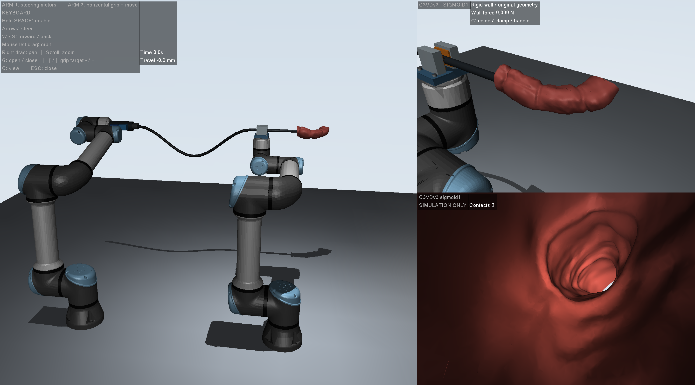

# Open-H-Simulation

双 UR5 内窥镜 MuJoCo 仿真与数据采集。

这个项目用于用键盘操作内窥镜，观察夹持、推进、回拉和转向，并采集仿真状态及内镜图像。使用 **MuJoCo 原生窗口**，不需要浏览器、ROS、真实机械臂或 Xbox 手柄。

- 第一只机械臂托住内窥镜手柄；手柄上的两个电机对应尖端上下、左右转向。
- 第二只机械臂末端安装小夹具，夹住水平贯穿的镜管，通过末端水平运动推送或回拉。
- 夹爪有开合、接触和摩擦；近端软管参与柔性动力学。
- 肠道使用官方 **C3VDv2 `c1_sigmoid1` 乙状结肠分段**，带开放入口和内壁碰撞结构。

项目沿用“双 UR5”名称，但项目采用的公开机器人几何与关节模型是 **UR5e**，不是经过实机标定的 UR5 模型。



## 1. 安装并启动

先克隆仓库并进入项目目录：

```bash
git clone https://github.com/Guo1ZY/Open-H-Simulation.git
cd Open-H-Simulation
```

也可以在 GitHub 页面点击 **Code → Download ZIP**，完整解压后，在包含本 README 和 `launch.py` 的目录打开终端。不要直接在压缩包内运行。

推荐 **Python 3.12（64 位）**。依赖首次安装需要网络；模型已经随仓库提供，安装完成后启动不需要下载模型。

### macOS / Linux

```bash
python3.12 -m venv .venv
./.venv/bin/python -m pip install --upgrade pip
./.venv/bin/python -m pip install -r requirements.txt
./.venv/bin/python launch.py
```

### Windows（PowerShell 或命令提示符）

```powershell
py -3.12 -m venv .venv
.\.venv\Scripts\python.exe -m pip install --upgrade pip
.\.venv\Scripts\python.exe -m pip install -r requirements.txt
.\.venv\Scripts\python.exe launch.py
```

这些命令直接使用虚拟环境里的 Python，无需激活环境，也不需要调整 PowerShell 执行策略。

**已验证平台：macOS arm64 + Python 3.12。Windows / Linux 启动方式已提供，但尚未实机验证。** 原生窗口需要图形桌面及可用的 OpenGL；不适合直接从没有显示服务的 SSH 会话启动。

## 2. 键盘与视角

先点击 MuJoCo 窗口，让它获得键盘焦点。默认夹爪闭合。

| 操作 | 功能 |
|---|---|
| 按住空格 + W / S | 第二只臂带着夹具前进 / 后退 |
| 按住空格 + 方向键 | 控制内窥镜尖端转向 |
| G | 夹紧 / 松开夹爪 |
| [ / ] | 减小 / 增大夹爪闭合位置目标，从而改变接触压力 |
| C | 右上角依次切换肠道、夹具、双电机手柄近景 |
| 左侧画面鼠标左键拖动 | 旋转总览视角 |
| 左侧画面鼠标右键拖动 | 平移总览视角 |
| 左侧画面滚轮 | 缩放 |
| Esc 或关闭窗口 | 退出并结束本次记录 |

左侧为双臂总览，右上为近景，右下为实时内镜视图。初始尖端位于入口内约 15 mm。向前推进约 30 mm 后会遇到弯道，需要配合转向；可先小幅推进，再尝试向右弯曲，观察右下角通道。

无参数启动 `launch.py` 时，默认是键盘模式、最多 **3600 秒仿真时间**、仅记录状态 CSV，不保存图像。仿真时间与实际耗时可能不同。

## 3. 采集内镜图像与状态

例如采集 60 秒仿真时间的图像和状态：

macOS / Linux：
```bash
./.venv/bin/python launch.py --mode keyboard --seconds 60
```

Windows：
```powershell
.\.venv\Scripts\python.exe launch.py --mode keyboard --seconds 60
```

添加 `--no-video` 可以关闭图像保存，保留状态 CSV。图像为 **640 × 480 PNG 序列**，每仿真秒 30 帧；状态采样为每仿真秒 50 次。图像保存会增加计算和磁盘开销。

每次运行输出到 `sim/recordings_native/日期_时间/`：

| 文件 | 内容 |
|---|---|
| `states.csv` | 输入、仿真时间、实际耗时、机械臂关节、夹爪位置、接触力、滑动、尖端位置等 |
| `metadata.json` | 本次运行模式及模型说明 |
| `frames/000000.png` 等 | 启用图像保存时生成的内镜帧 |

`frame_index` 对应最近保存的图像编号；配合 `sim_time_s` 对齐图像和状态。未保存图像时该值为 −1。帧率和采样率均按**仿真时间**计算，不保证实际运行达到实时速度。

也可以将 `--mode keyboard` 改为 `--mode xbox`：LB 按住使能、左摇杆转向、RT / LT 推进与回拉。当前手柄映射**未用实体 Xbox 手柄验证**，夹爪开合仍通过键盘 G 操作。

## 4. 检查与重新构建

不打开图形窗口的模型检查：

```bash
# macOS / Linux
./.venv/bin/python sim/verify_colon.py
```
```powershell
# Windows
.\.venv\Scripts\python.exe sim/verify_colon.py
```

它会检查入口可通行、弯曲肠壁能产生碰撞，以及有限的前进、转向和回拉轨迹。输出位于 `sim/verification/`。已有验证结果只覆盖这段测试轨迹，不表示整段结肠都已验证通行。

日常启动不需要重新构建模型。修改模型构建代码后，可安装额外依赖并重新生成场景：

```bash
# macOS / Linux
./.venv/bin/python -m pip install -r requirements-build.txt
./.venv/bin/python rebuild.py
```
```powershell
# Windows
.\.venv\Scripts\python.exe -m pip install -r requirements-build.txt
.\.venv\Scripts\python.exe rebuild.py
```

`rebuild.py` 使用随仓库提供的几何缓存和源模型，依次运行两个构建脚本。它不会重新下载肠道。`sim/colon/geometry.json` 存在时会复用已处理的网格；若修改网格处理流程，应先备份并移除 `sim/colon/`，再重新构建，完整处理原始网格会更慢。

## 5. 文件结构

```text
Open-H-Simulation/
├── README.md
├── THIRD_PARTY_NOTICES.md       # 第三方模型来源、许可与修改说明
├── launch.py                   # 原生窗口入口
├── rebuild.py                  # 可选：重新生成场景
├── requirements.txt            # 运行依赖
├── requirements-build.txt      # 可选：构建依赖
├── preview.png
├── sim/                        # 控制代码、场景、派生肠道网格、验证脚本
├── ur5e/                       # UR5e 模型、网格与许可证
└── assets/c3vdv2/              # 官方肠道源模型与来源记录
```

## 6. 当前模型范围

这是用于控制演示和仿真数据采集的研究原型。肠壁目前是**刚性碰撞壳**，没有软组织变形；显示颜色是示意材质，没有使用真实黏膜 RGB 纹理。近端和远端镜管采用分段柔性模型，两部分之间为点连接约束，不能完整传递连续软管的所有弯矩；轴向滑移仍以夹具坐标系为参考。重力关闭，机械臂之间及附件之间没有完整的碰撞建模。

夹紧力、摩擦、刚度和阻尼没有经过实测标定。记录值都是仿真值，不能直接作为真实设备的安全载荷或控制参数。

模型来源、署名和许可证见 [THIRD_PARTY_NOTICES.md](THIRD_PARTY_NOTICES.md)。C3VDv2 采用 CC BY 4.0；UR5e 模型采用 BSD-3-Clause。分享或修改时请保留相应署名、许可证和修改说明。

## 常见问题

- **提示找不到模块**：确认使用的是上面 `.venv` 内的 Python，并已安装 `requirements.txt`。
- **窗口打不开或 GLFW / OpenGL 报错**：先确认处于本机图形桌面，图形驱动和 OpenGL 可用；无图形环境可先运行 `verify_colon.py`。
- **按键没有反应**：先点击仿真窗口；推进和转向需要一直按住空格。
- **画面或运行变慢**：使用 `--no-video` 关闭 PNG 保存。仿真时间可能慢于实际时间。
- **移动 ZIP 或项目后找不到模型**：请完整解压并保留上述目录结构，不要单独复制 `native.py` 或 `scene.xml`。
